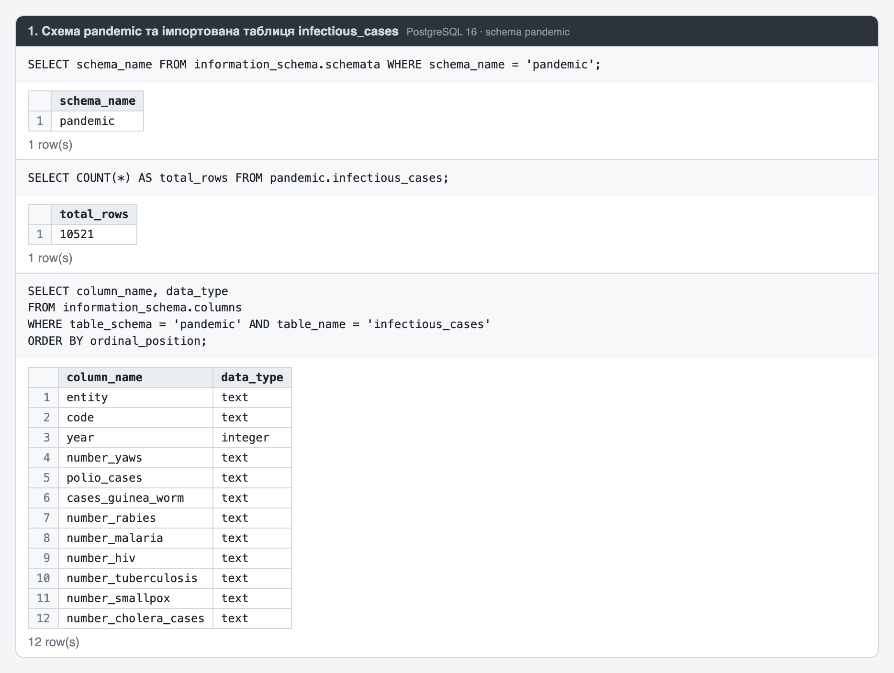
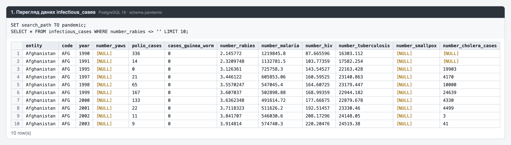
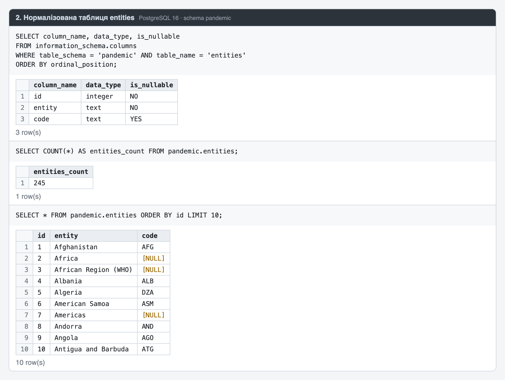
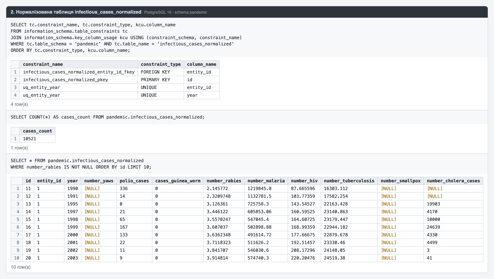
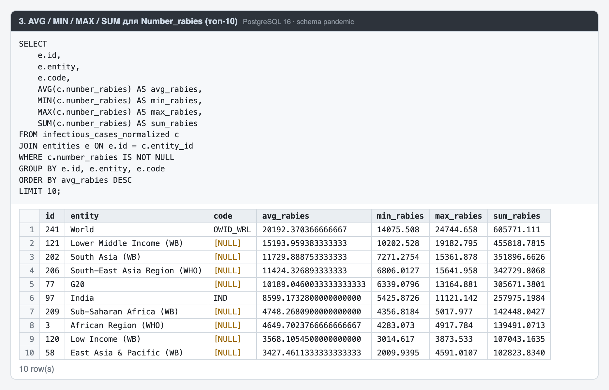
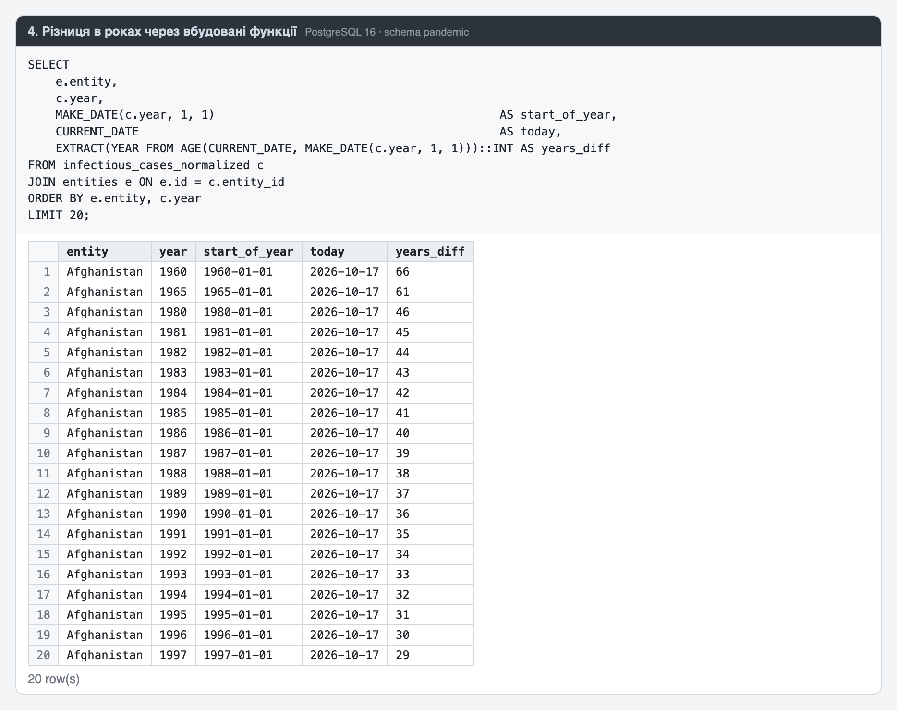
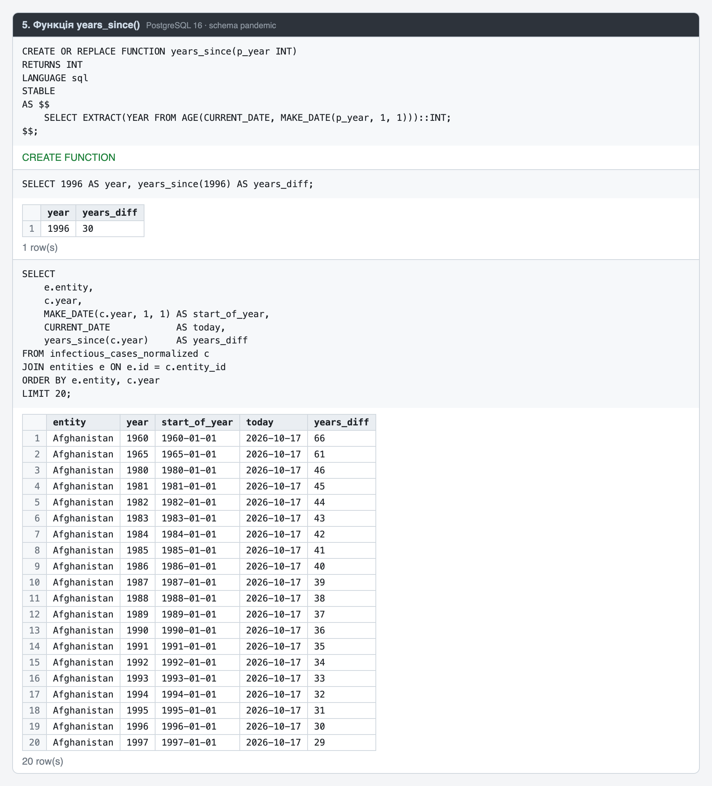
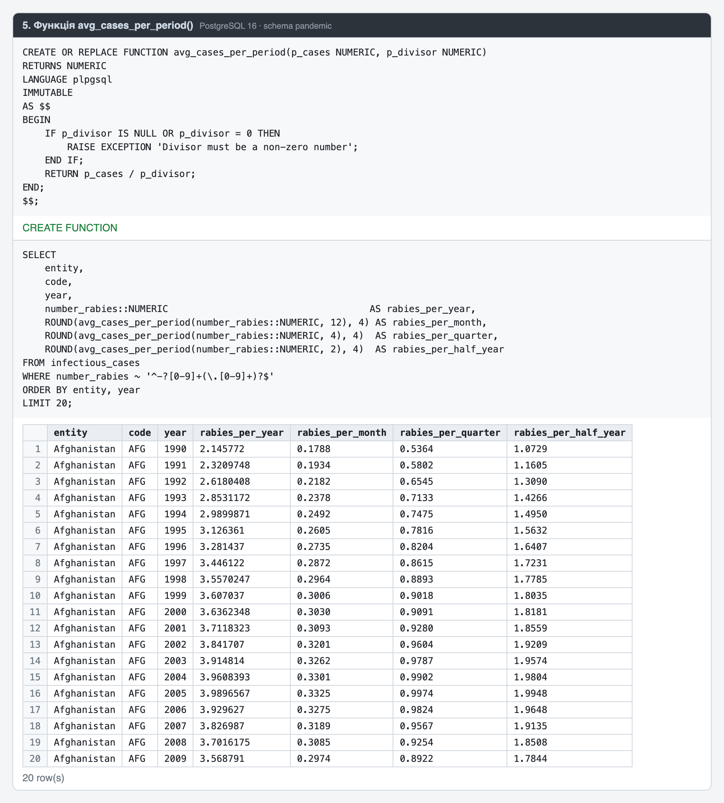

# goit-rdb-fp

Фінальний проєкт з курсу реляційних баз даних (PostgreSQL). Тут аналізується датасет `infectious_cases`: статистика інфекційних захворювань за країнами та роками.

## Структура

```
data/infectious_cases.csv     — вихідний датасет
common.sql                    — усі запити (завдання 1–5) в одному файлі
tasks/01_load_data.sql        — 1. схема pandemic, імпорт CSV, перегляд даних
tasks/02_normalize.sql        — 2. нормалізація до 3НФ
tasks/03_analysis.sql         — 3. AVG / MIN / MAX / SUM для Number_rabies, топ-10
tasks/04_year_difference.sql  — 4. дата 1 січня, поточна дата, різниця в роках
tasks/05_functions.sql        — 5. функції years_since() та avg_cases_per_period()
screenshots/                  — скриншоти таблиць, запитів і результатів
```

## Запуск

Запускайте з кореня репозиторію, бо `\copy` бере шлях до CSV відносно поточної директорії:

```bash
psql -d <database> -v ON_ERROR_STOP=1 -f common.sql
```

Або по завданнях, по черзі:

```bash
for f in tasks/0*.sql; do psql -d <database> -v ON_ERROR_STOP=1 -f "$f"; done
```

Якщо працюєте в DBeaver або pgAdmin, виконайте `tasks/01_load_data.sql` (або блок «Завдання 1» з `common.sql`) без рядка `\copy`, а `data/infectious_cases.csv` імпортуйте в `pandemic.infectious_cases` через майстер імпорту. Після цього запустіть решту запитів.

## Хід виконання

### 1. Завантаження даних

Створено схему `pandemic` і задано її як схему за замовчуванням (`SET search_path`). Дані з CSV імпортовано командою `\copy` у таблицю `infectious_cases`. Показники збережено як `TEXT`, щоб порожні клітинки та дробові числа імпортувалися без втрат. У таблиці 10 521 рядок.




### 2. Нормалізація до 3НФ

У вихідній таблиці пара `Entity`/`Code` повторюється в кожному рядку, а `Code` залежить від `Entity`. Тому дані розбито на дві таблиці:

| Таблиця | Колонки |
|---|---|
| `entities` | `id` PK, `entity`, `code` (для регіонів без ISO-коду — `NULL`), `UNIQUE(entity, code)` |
| `infectious_cases_normalized` | `id` PK, `entity_id` FK → `entities.id`, `year`, показники як `NUMERIC`, `UNIQUE(entity_id, year)` |

Вийшло 245 записів в `entities` і 10 521 в `infectious_cases_normalized`. Порожні значення в нормалізованій таблиці перетворено на `NULL`.




### 3. Аналіз Number_rabies

Для кожної пари `Entity`/`Code` пораховано `AVG`, `MIN`, `MAX` і `SUM`. Результат відсортовано за середнім значенням у порядку спадання і обмежено 10 рядками. Записи без значення `Number_rabies` не враховуються.



### 4. Різниця в роках

`MAKE_DATE(year, 1, 1)` дає дату 1 січня, `CURRENT_DATE` — поточну дату, а `EXTRACT(YEAR FROM AGE(...))` — кількість повних років між ними.



### 5. Власні функції

- `years_since(year INT) → INT`: скільки повних років минуло від `year-01-01` до `CURRENT_DATE`. Наприклад, `1996 → 1996-01-01 → 30`.
- `avg_cases_per_period(cases NUMERIC, divisor NUMERIC) → NUMERIC`: ділить річну кількість захворювань на кількість періодів (12 — місяць, 4 — квартал, 2 — півріччя). Якщо дільник дорівнює 0, функція повертає помилку. У запиті використано лише записи, де `Number_rabies` є числом (перевірка регулярним виразом).



